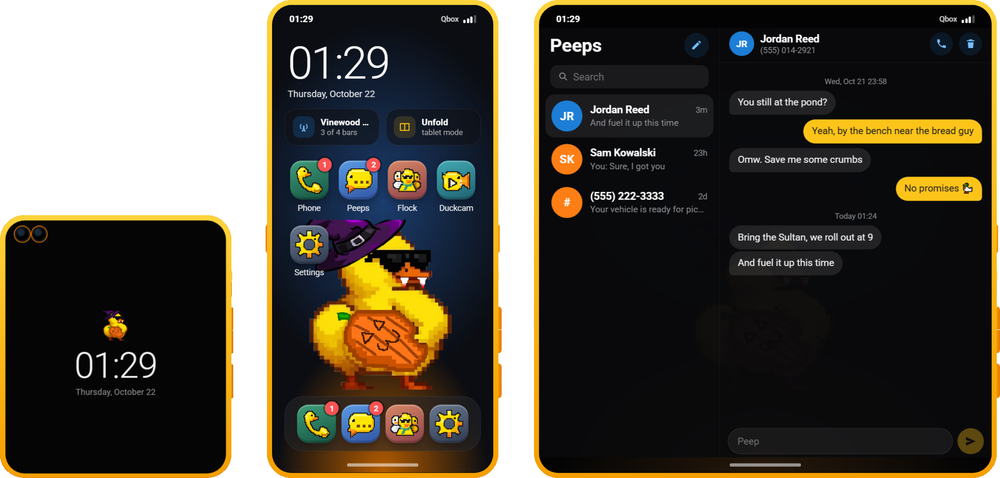
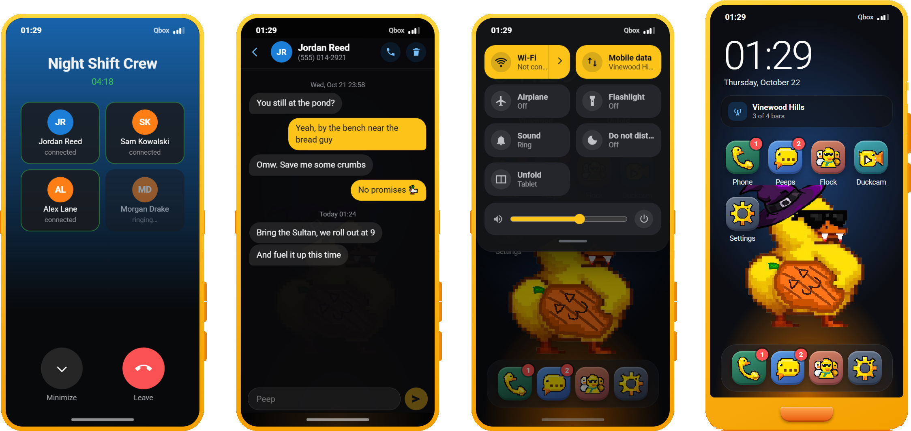

# qbx_phone

A duck-themed phone for Qbox and a drop-in replacement for npwd. The default device is the **Flip-Flop**: a flip phone with a cover screen that also unfolds sideways into a tablet. The **Bill**, a slab phone with a duck-bill chin, is available as a second style.

[:material-github: Repository](https://github.com/Epixx1337/qbx_phone){ .md-button } [Installation](install.md){ .md-button .md-button--primary } [FAQ](faq.md){ .md-button }

## What's inside

- **Three fold modes**: closed (cover screen glance), open (phone) and unfolded (tablet). Every app has a layout for each, and the phone folds and unfolds with the app still open.
- **Calls over pma-voice**, including **group calls** to a contact group, with no changes to pma-voice.
- **Peeps**: texting to contacts or any number, with read receipts and unread badges.
- **Flock**: the phone's social feed. Quack, requack, like, reply in threads, mention with `@handle` and follow accounts, with a For you and a Following tab. Admins moderate it from `/phoneadmin`.
- **Quackers**: contacts, favourites and contact groups. Give your number to the player in front of you from the radial menu; they get an accept prompt.
- **Duckcam** video calls, relayed through a Cloudflare TURN key you provide. Off until you add one.
- Optional **SIM cards**: the phone becomes a one-slot ox_inventory container and the number lives on the SIM.
- Optional **cell towers** and **Wi-Fi networks** placed by you, with signal bars, Wi-Fi calling and Wi-Fi-only apps.
- **Quick settings** from the signal bars: Wi-Fi, mobile data, airplane mode, a synced flashlight, do not disturb, sound mode, volume and power.
- **Side buttons**: a volume rocker, a ring / vibrate / silent slider and a power button with a Qbox boot screen. New characters start with the phone off.
- Duck ringtones and notification tones synthesized in the browser, so there are no audio files to license.
- Badges that clear when you open the app or tap the notification.
- **Everything lives on the phone**: contacts, settings, texts and the Flock login. Steal a phone and you see its owner's data, not your own. A **Duck Cloud** backup lets the owner restore onto a new phone.
- Texts sent to a phone without signal wait and arrive when it gets service back.
- A **custom app API** with ready-made templates, and a `/phoneadmin` panel.
- **npwd compatibility**: the npwd exports other resources call keep working, and the stock radial menu entry works unchanged.

## Where to go next

| Page | For |
| --- | --- |
| [Installation](install.md) | dependencies, items, first start |
| [FAQ & troubleshooting](faq.md) | the questions we get |
| [Configuration](config.md) | every config key and player setting |
| [Items and SIM cards](items.md) | the phone item and SIM containers |
| [Cell towers](towers.md) | coverage, signal and the debug view |
| [Wi-Fi, quick settings and flashlight](wifi.md) | networks, passwords, Wi-Fi-only apps |
| [Voice and group calls](voice.md) | how calls use pma-voice |
| [Duckcam video calls](duckcam.md) | the Cloudflare TURN setup |
| [Flock](quackers.md) | the social feed, notifications and moderation |
| [Exports and events](exports.md) | notifications, texts, npwd compatibility |
| [Custom apps](apps.md) | add an app from your own resource |
| [Built-in apps](built-in-apps.md) | contribute an app to the phone itself |
| [Admin panel](admin.md) | `/phoneadmin`, including Flock moderation |
| [Full reference](readme.md) | mirrored from the repo |
